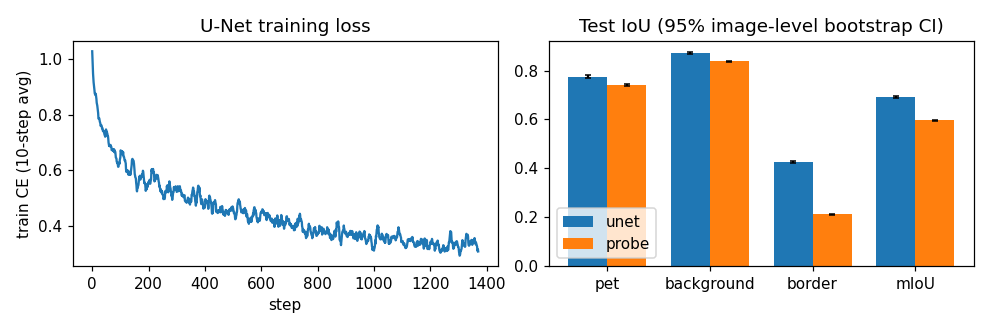
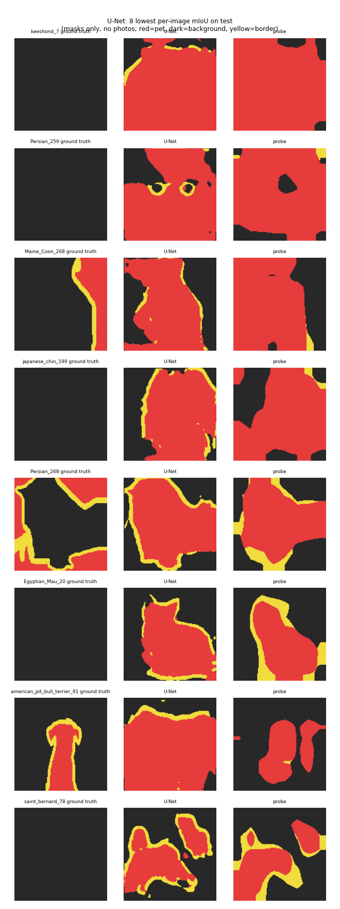
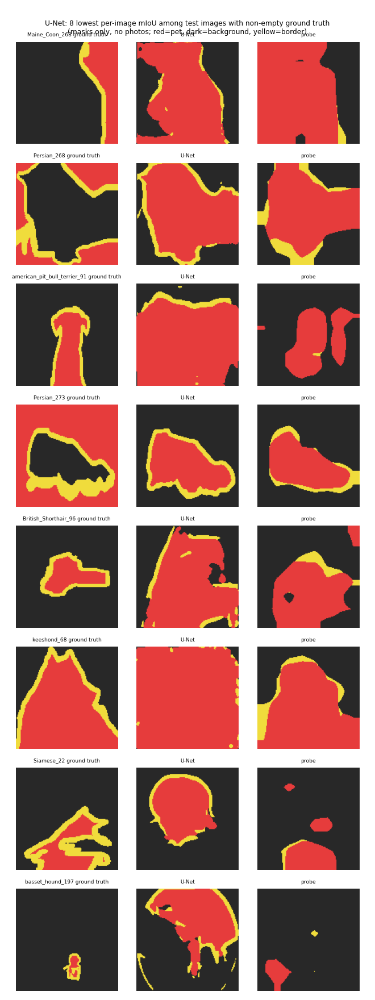
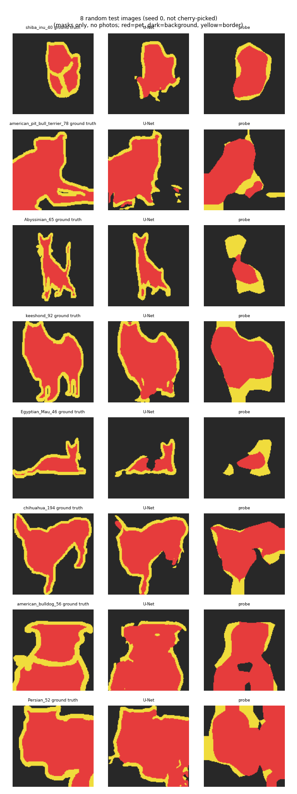

# Oxford-IIIT Pet segmentation: small U-Net from scratch vs. a frozen-feature linear probe

[](https://github.com/MoustafaMZaalouk/oxford-pet-unet-segmentation/actions/workflows/ci.yml) Synthetic-data tests only, not the full training run.

A small 3-class (pet / background / border) semantic segmentation study on the Oxford-IIIT Pet trimaps, trained **from scratch on one CPU thread** under a limited compute budget. It is a learning project, not a benchmark entry.

## Results (official test split, 3669 images, single run, seed 0)

| Model | pet IoU | background IoU | border IoU | mIoU | pixel acc |
|---|---|---|---|---|---|
| U-Net from scratch (7.85M params) | 77.4 [76.8, 78.0] | 87.3 [86.9, 87.7] | 42.6 [42.2, 43.0] | 69.1 [68.7, 69.5] | 87.8 [87.6, 88.1] |
| Frozen ResNet-18 (ImageNet) + linear probe (771 params) | 74.0 [73.5, 74.4] | 83.7 [83.4, 84.0] | 21.2 [20.9, 21.4] | 59.6 [59.3, 59.9] | 83.9 [83.7, 84.1] |

IoU and pixel accuracy are in %, computed from the confusion matrix pooled over all test pixels at 128x128. Brackets are 95% percentile CIs from an **image-level bootstrap** (1000 resamples of test images with replacement).
Paired difference in mIoU (U-Net minus probe): +9.5 points, 95% CI [+9.2, +9.8]. The U-Net scores higher than the probe on mIoU and the paired 95% CI excludes zero.

Other numbers from the same artifacts: final U-Net training loss (mean of last 50 steps) 0.337; median per-image mIoU of the U-Net 70.6%; lowest per-image mIoU of the U-Net on any test image 3.9%.

**Label noise (checked, not assumed):** 7 of the 3669 test images have a raw trimap with no pet or border pixels at all (every pixel is background), although every dataset image is meant to contain a pet (I did not inspect the photos individually). 5 of the 8 worst U-Net failures below are of this kind, so they reflect annotation errors in the dataset, not model failures. Sensitivity check, mIoU on the remaining 3662 images: U-Net 69.2%, probe 59.7%. The headline table above keeps all official test images, as the protocol says; this exclusion is only a disclosed side analysis.

Figures: `results/iou_and_loss.png` (loss curve and per-class IoU with CIs), `results/failure_panel_unet_worst8.png` (masks for the 8 worst test images by per-image mIoU: ground truth, U-Net and probe predictions; photos omitted on purpose), `results/failure_panel_unet_worst8_nonempty_gt.png` (same, restricted to images with non-empty ground truth), `results/random_panel_seed0.png` (8 random test images, not cherry-picked).






All numbers above are generated by `python -m petseg report` from `results/per_image_confusion_*.npy` and `results/train_log.json` (committed). `results/metrics.json` holds the full set. This README is built from `README.template.md`; do not edit numbers by hand.

## Setup

- **Data**: Oxford-IIIT Pet, official `trainval` (3680 images) and `test` (3669 images) lists from the dataset's own annotations. Trimap classes: pet, background, border (the uncertain outline band). Border pixels are evaluated as a third class, not ignored. The test split is used once, for final evaluation. There is no hyperparameter tuning and no validation-based model selection: epochs, learning rate and schedule were fixed before training.
- **Preprocessing**: images resized (squashed, aspect ratio not preserved) to 128x128 with bilinear interpolation; trimaps with nearest neighbour. ImageNet mean/std constants for normalisation (fixed constants, not fitted on any split).
- **U-Net** (`src/petseg/unet.py`): written in this repo, 4 down/up levels, widths 32-64-128-256-512, BatchNorm, bilinear upsampling, **7,849,667 parameters**, random init, no pretrained weights. Adam, lr 1e-3 with cosine decay, batch 16, 6 epochs (1380 steps), cross-entropy, seed 0.
- **Augmentation (training only)**: horizontal flip (p=0.5); random translation up to 12 px with reflect padding (image and mask together); brightness scales the image mean by U(0.8,1.2), while contrast scales deviations around that mean by U(0.8,1.2) (image only). No augmentation at evaluation.
- **Baseline** (`src/petseg/evaluate.py`): torchvision ResNet-18 with **ImageNet-pretrained weights**, frozen, layer3 features (stride 16, 8x8 at 128 px), a per-pixel linear classifier (1x1 conv, **771 parameters**), logits bilinearly upsampled to 128x128. Adam, 10 epochs, no augmentation (features are cached).
- **Compute budget (plain statement)**: CPU only, 1 thread, 1 GB RAM sandbox, PyTorch 2.5.1+cpu. U-Net training took about 82 minutes of wall-clock time. This is a deliberately small budget; the model is trained for few epochs and is almost certainly under-trained. No claim is made about what more compute would give, and **no comparison is made to published results**, which use different resolutions, losses, splits and GPU budgets.

## Reading the comparison honestly

- The two models are not equally handicapped: the probe uses ImageNet-pretrained features (external data), the U-Net sees only the 3680 training images. The comparison shows what each recipe achieves under this budget, not which architecture is better.
- The probe is very coarse by construction (stride-16 features), which mainly hurts the thin border class. Border IoU is low for both models; that class is hard at 128 px because it is a narrow, ambiguous band.
- CIs reflect test-set sampling only (which images), not training randomness: only one seed was trained per model. Differences smaller than seed-to-seed variation would not be detected here.

## Limitations

- One seed, one run. No variance across seeds.
- Under-trained: 6 epochs on one CPU thread. No learning-rate or architecture search.
- 128x128 squashed inputs; metrics are at 128 px, not original resolution.
- The official split is by image. I did not check whether near-duplicate photos exist across trainval and test, so some optimism from near-duplicates cannot be ruled out.
- Pixel-pooled metrics weight large pets more than small ones; per-image mIoU would rank differently.
- Failure panels show the lowest per-image scores plus a random sample; they are illustrations, not a systematic error analysis.
- Probe's feature choice (layer3 only) was made once, not compared against alternatives.

## Reproduce (one command)

```bash
python -m venv .venv && . .venv/bin/activate
pip install -r requirements.txt --extra-index-url https://download.pytorch.org/whl/cpu
bash scripts/reproduce.sh
```

`scripts/reproduce.sh` downloads the dataset (SHA-256 verified against pins in `src/petseg/data.py`), downloads ResNet-18 weights (verified by SHA-256), then runs prep, train, probe, eval and report. Fixed seeds; all randomness in training is derived from (seed, epoch, step). Expect roughly 1.5-2 hours on one CPU thread; results may differ slightly on other hardware or PyTorch builds.

**Checkpoint/resume**: training saves an atomic checkpoint every 10 steps; evaluation and feature extraction are chunked. Re-running any stage resumes. `python -m petseg train --max-seconds N` stops cleanly after N seconds (exit code 3) and the same command continues. A test (`tests/test_checkpoint.py`) verifies that an interrupted-and-resumed run gives bit-identical weights to an uninterrupted one. This is how the reported run was produced, in ~2-minute chunks.

## Tests and CI

`pytest` runs on synthetic data only (no dataset download in CI): checkpoint/resume determinism, leakage guards (disjoint trainval/test lists, no augmentation at eval, no test data in training code path), metric correctness, parameter count, and a check that the README numbers match `results/metrics.json`. See `.github/workflows/ci.yml`.

## Data license and provenance

Oxford-IIIT Pet dataset (Parkhi, Vedaldi, Zisserman, Jawahar): the dataset page states it is available for commercial/research purposes under **Creative Commons Attribution-ShareAlike 4.0 International**, and that copyright remains with the original owners of the images. Page capture, headers, retrieval time and hash are in `evidence/`. **No images or masks are committed or redistributed by this repo**; they are downloaded at build time into the git-ignored `data/` folder. The cached 128 px arrays are likewise git-ignored. Committed results contain only derived statistics and figures. The failure and random panels show **segmentation masks only (no photographs)**, titled with the image file name so a reader can look the photo up in the downloaded dataset.

Citation: O. M. Parkhi, A. Vedaldi, A. Zisserman, C. V. Jawahar, "Cats and Dogs", CVPR 2012. ResNet-18 weights: torchvision `IMAGENET1K_V1`.

## AI assistance disclosure

This repository was written with the help of AI coding assistants, directed and reviewed by the repository owner. The code, tests and README were generated with AI assistance; the results come from running the code as committed.

## License

Code: MIT (see `LICENSE`). The dataset has its own license (above) and is not part of this repository.
